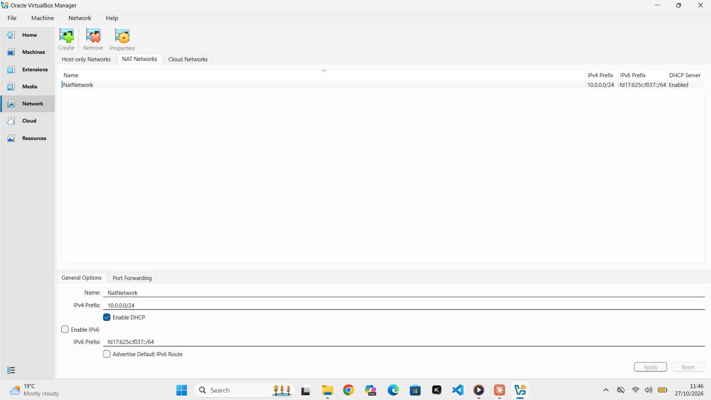
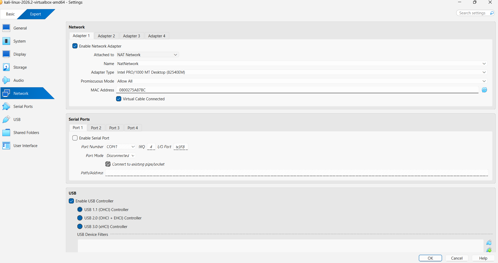
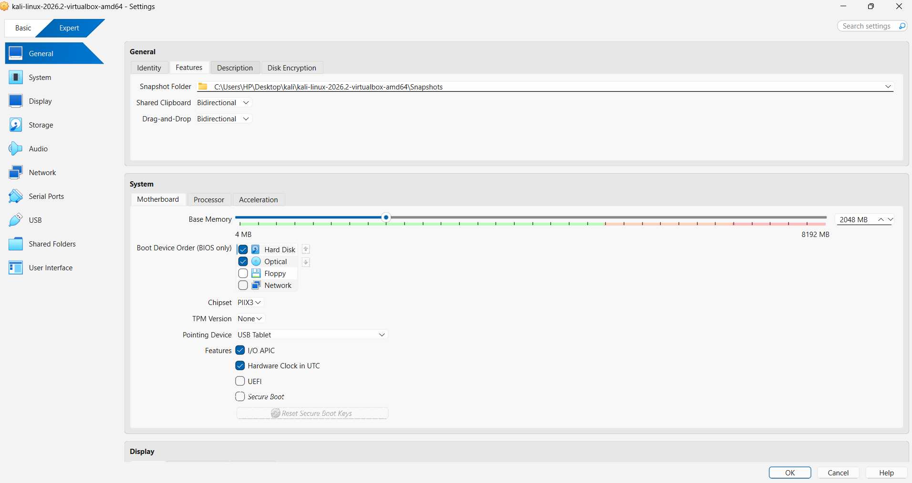
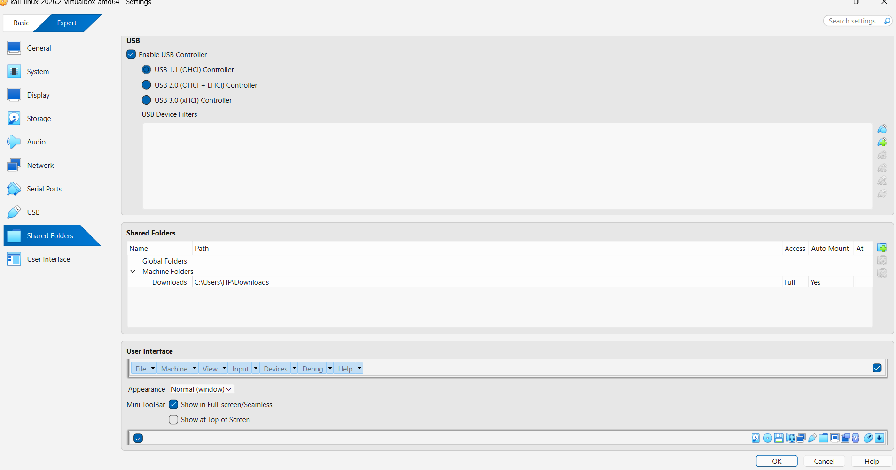
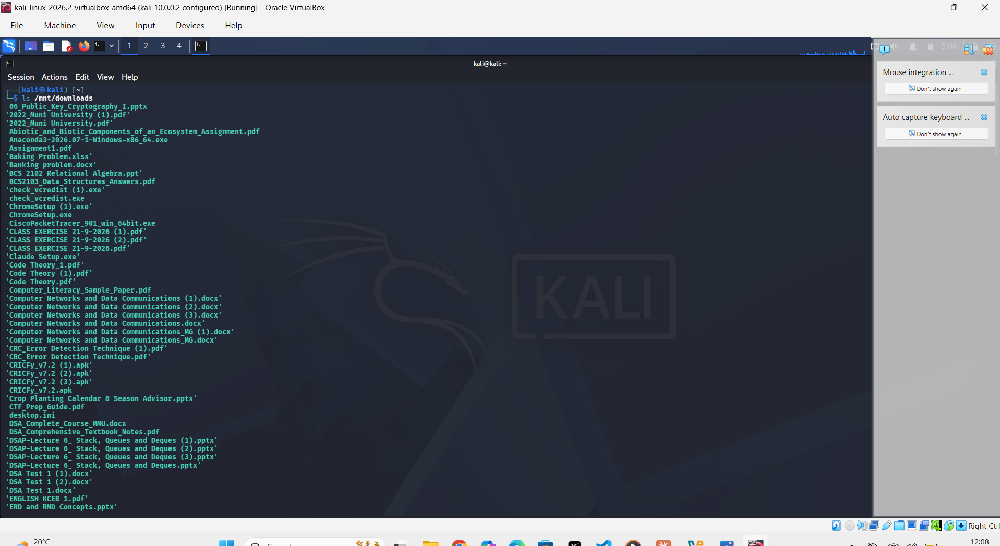
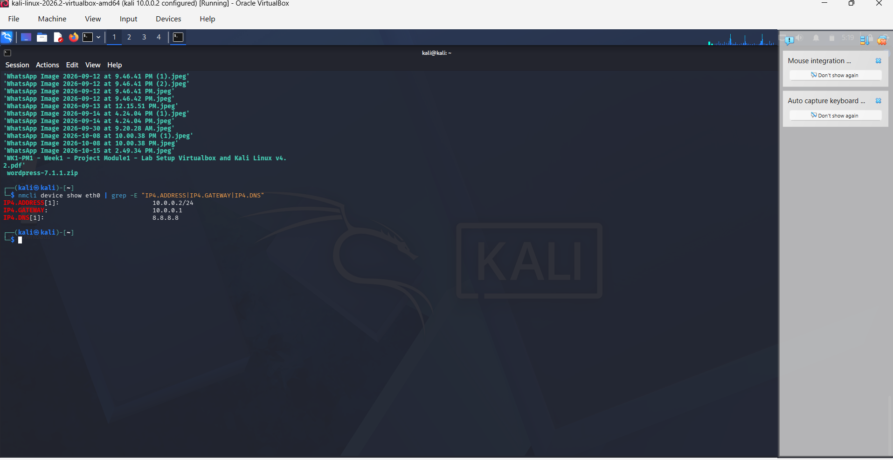
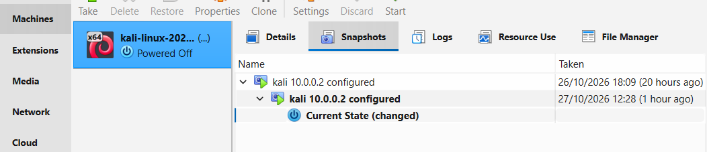
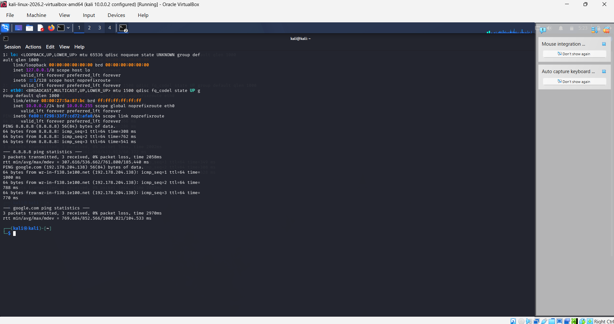
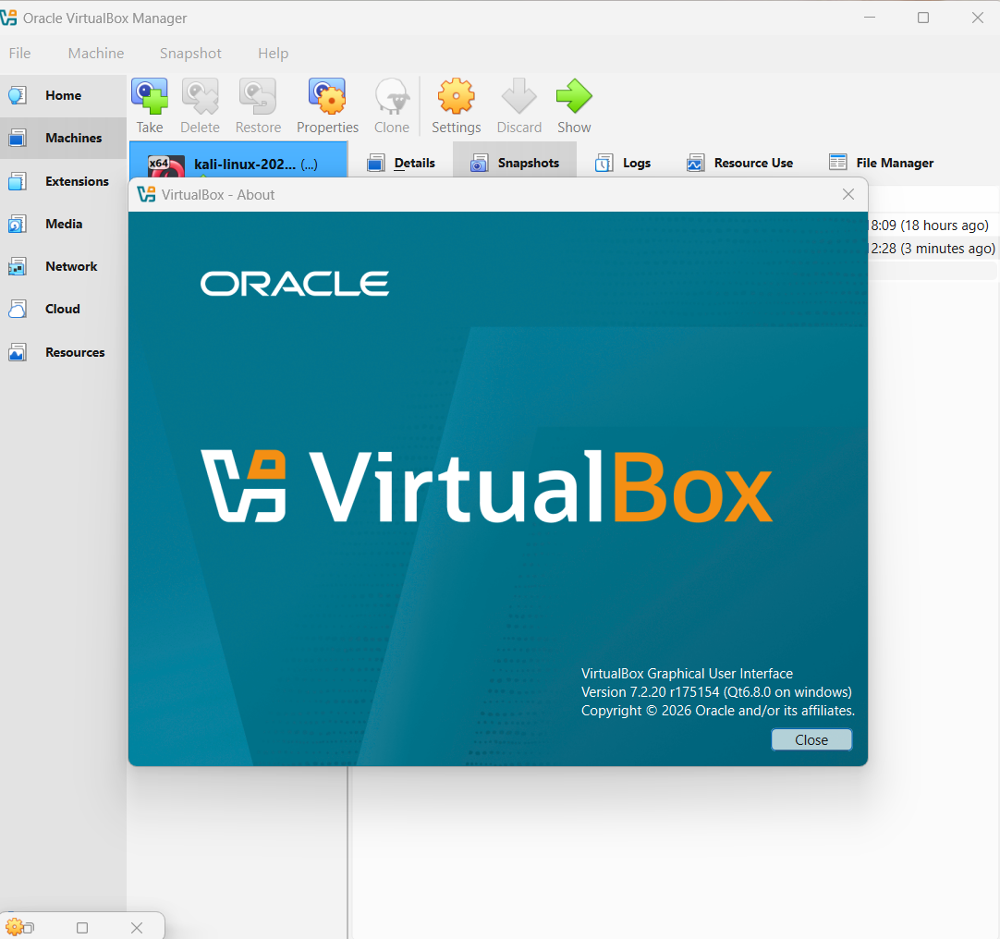

# My Cybersecurity Lab: VirtualBox + Kali Linux

Networkwalks, Week 1, Project Module 1


By Muhumuza Nicholas

## What this project is

This is my first project in the Networkwalks cybersecurity program. The task was to build a small lab on my own laptop where I can practise with Kali Linux without touching my real Windows system.

I used VirtualBox to run Kali inside a private network (10.0.0.0/24). Later I can add more virtual machines to the same network and use them as targets, but only for testing I am allowed to do.

## What I had to do

- Install VirtualBox and import the Kali VM
- Make a NAT Network on 10.0.0.0/24
- Give Kali the IP address 10.0.0.2/24
- Make sure Kali has internet
- Turn on shared clipboard and drag and drop
- Share my Downloads folder from Windows to Kali
- Take a snapshot when everything works

## My laptop and lab details

| Item | What I used |
|---|---|
| Windows | Windows 11, 64-bit |
| Processor | 13th Gen Intel Core i7-1315U |
| RAM | 8 GB (7.65 GB usable) |
| Storage | 238 GB, about 134 GB already used |
| VirtualBox | 7.2.20 |
| Kali Linux | 2026.2 |
| RAM given to Kali | 2048 MB |
| Network | NAT Network called NatNetwork |
| Subnet | 10.0.0.0/24 |
| Kali IP | 10.0.0.2/24 |
| Gateway | 10.0.0.1 |
| DNS | 8.8.8.8 |
| Shared folder | C:\Users\HP\Downloads, mounted in Kali at /mnt/downloads |
| Snapshot name | Kali 10.0.0.2 configured |

## How I did it

### 1. NAT Network

In VirtualBox I went to Tools, then Network, then the NAT Networks tab, and created a network. I named it NatNetwork, set the prefix to 10.0.0.0/24, and left DHCP on.



### 2. Kali VM settings

With Kali powered off, I opened its settings. Adapter 1 is attached to NAT Network, using NatNetwork, and I changed Promiscuous Mode to Allow All.



Then I set Shared Clipboard and Drag and Drop to Bidirectional.



### 3. Shared folder

I added my Windows Downloads folder as a shared folder named Downloads, with auto-mount on.



In Kali it did not show up by itself, so I mounted it by hand:

```bash
sudo mkdir -p /mnt/downloads
sudo mount -t vboxsf Downloads /mnt/downloads
```

After that, `ls /mnt/downloads` showed my Windows files.



To make it mount again after a reboot, I added this line to /etc/fstab:

```bash
echo 'Downloads /mnt/downloads vboxsf defaults,uid=1000,gid=1000,nofail 0 0' | sudo tee -a /etc/fstab
```

### 4. Static IP address

I set the address with nmcli. The last part (dad-timeout) is the fix from the course slides for the internet problem on newer VirtualBox and Kali.

```bash
sudo nmcli connection modify "Wired connection 1" ipv4.method manual ipv4.addresses 10.0.0.2/24 ipv4.gateway 10.0.0.1 ipv4.dns 8.8.8.8 ipv4.dad-timeout 0
sudo nmcli connection down "Wired connection 1"
sudo nmcli connection up "Wired connection 1"
```



### 5. Snapshot

When everything was working I took a snapshot called "Kali 10.0.0.2 configured", so I can go back to this point if I break something later.



## Checking that it works

I ran `ip a`, then pinged 8.8.8.8 and google.com. Kali shows 10.0.0.2/24 on eth0 and both pings had 0% packet loss, so the internet and DNS are working.



I also checked the route with `ip route` (default goes through 10.0.0.1) and the shared folder with `sudo VBoxControl sharedfolder list`.

This is the VirtualBox version I used:



## Problems I had

**Promiscuous Mode was on Deny.** When I opened the network settings of the Kali VM it said Deny. The slides use Allow All, so I changed it.

**I made a typing mistake in nmcli.** I typed `ipv4.data-timeout` and got an error. The error printed a list of the valid options, and I saw the right word was `dad-timeout`. I ran the command again and it worked.

**The shared folder was not in Kali.** After rebooting, the folder was missing from /media. I ran `VBoxControl sharedfolder list` and it said there were 0 shared folders. The driver was loaded, so Kali was fine. The share simply was not saved in VirtualBox.

**"Shared folder path 'Downloads' is not absolute".** When I tried to add the share again, VirtualBox gave me this error. I had typed only the word Downloads in the path box. It needs the full Windows path, so I browsed to C:\Users\HP\Downloads and then it saved.

**Mount after reboot.** Once the share existed, I mounted it manually. Then I put it in /etc/fstab so it comes back every time Kali starts.

## What I learned

A NAT Network is different from the normal NAT option. With a NAT Network, several VMs can sit on the same private network and talk to each other, and they can still reach the internet. That is what I need for a lab with more than one machine.

I also learned how the IP address, netmask, gateway and DNS fit together, and that error messages are worth reading properly because both of my errors told me exactly what was wrong.

The shared folder taught me to check the VirtualBox side first. If VirtualBox is not sharing the folder, Kali cannot mount it.

## Use of this lab

This lab is only for learning. I will only test machines that belong to me or where I have permission.

## Links I used

- 7-Zip: https://7-zip.org/download.html
- VirtualBox: https://virtualbox.org/wiki/Downloads
- Kali Linux: https://kali.org/get-kali

## About me

Muhumuza Nicholas


Cybersecurity program student, Networkwalks Academy
LinkedIn: https://www.linkedin.com/in/muhumuza-nicholas-669109447/
